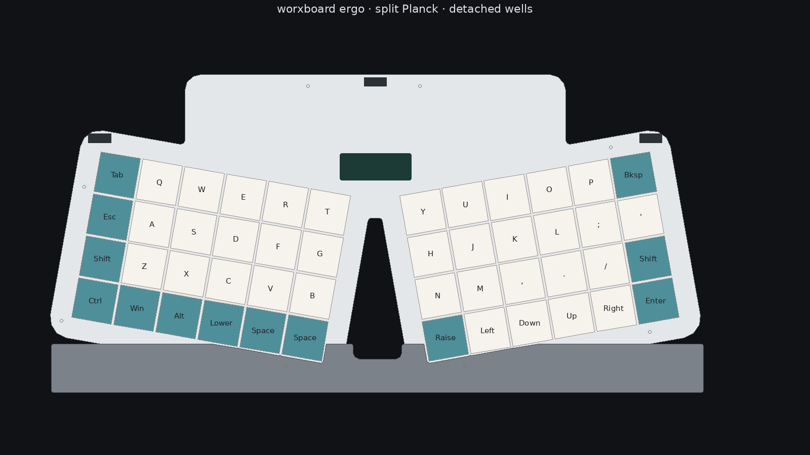

# worxboard ergo



A split Planck in one deck. Two blocks of four rows by six columns, every key 1u, opened ten degrees so the valley faces the typist. A low rear bay holds the memory LCD and the center USB-C jack. A short palm rest dips in the middle.

**Revision A0 is an engineering starter.** Case geometry and the firmware compile are checked. The boards are placed and unrouted. This is not a fabrication release, and no keyboard has been built.

The visual introduction is the microsite: the real outline, a Base / Lower / Raise switcher, and a plain line between what you can mill or print and what you cannot order.

```sh
python3 -m http.server 8765
```

Then open [http://127.0.0.1:8765/site/](http://127.0.0.1:8765/site/). The page is [`site/index.html`](site/index.html).

| Piece | Choice |
|---|---|
| Layout | 48 ortholinear keys. Numbers and F-keys live on Lower. |
| Ergonomics | 10° splay, one rigid board, short palm rest, about 7° negative tilt from the feet |
| Full-height | Cherry MX-compatible switches, Kailh MX hot-swap, 1.5 mm plate |
| Low-profile | Kailh Choc v1 / PG1350 hot-swap, its own plate and PCB |
| Controller | Bare RP2040, 16 MiB QSPI flash, reset, BOOT, and SWD |
| Cable | Three USB-C positions, one host at a time. No battery, Bluetooth, or radio |
| Selection | TS3USB3031 data mux. Center-first at startup. VBUS meets only through diodes |
| Display | nice!view-class 160×68 Sharp memory LCD. Labels BASE, LOWER, RAISE |
| Firmware | Pinned ZMK. The UF2 matches this grid. Compilation is not a typed keyboard |
| Size | Deck about 290 × 138 mm. With the palm rest, about 292 × 142 mm |
| Electronics | KiCad 10 schematics and placed footprints. **Zero tracks.** |

The three USB-C receptacles are alternative cable positions. They are not hub ports. Launch’s hub, QMK firmware, configurator, and certifications do not transfer. The upstream tree is a pinned [reference submodule](references/system76-launch). [Feature coverage](docs/launch-coverage.md) records the differences.

## Start here

- **[Microsite](site/index.html)** — shape, layers, and shop limits.
- **[Shop and bench guide](docs/build.md)** — coupons, print, CNC, and the blocked PCBA.
- **[CNC traveler](docs/cnc.md)** — operation order. No posted toolpath.
- **MX** — [assembly STEP](cad/exports/mx/assembly.step), [printable parts](cad/exports/mx), [KiCad project](pcb/mx/worxboard-ergo-mx.kicad_pro), [FreeCAD](cad/exports/mx/worxboard-ergo-mx.FCStd).
- **Choc v1** — [assembly STEP](cad/exports/choc/assembly.step), [printable parts](cad/exports/choc), [KiCad project](pcb/choc/worxboard-ergo-choc.kicad_pro), [FreeCAD](cad/exports/choc/worxboard-ergo-choc.FCStd).
- **Firmware** — [board](firmware/boards/worxbend/worxboard_ergo), [UF2](firmware/artifacts/worxboard-ergo.uf2), [build notes](docs/firmware.md).
- **Record** — [design](docs/design.md), [electrical](docs/electrical.md), [KiCad seed](docs/pcb-seed.md), [BOM](docs/bom.csv), [assembly](docs/assembly.md), [verification](docs/verification.md), [roadmap](docs/roadmap.md).

The parametric source is [layout/model.py](layout/model.py) and [cad/model.py](cad/model.py). Keycaps, the display, and the PCB in the assembly STEP are envelopes. The keycap solids are not printable keycaps. `docs/bom.csv` is an illustrative list marked not for order.

## Reproduce

Install [uv](https://docs.astral.sh/uv/), Docker, and FreeCAD 1.1.x.

```sh
git clone https://github.com/w0rxbend/worxboard-ergo.git
cd worxboard-ergo
uv sync --locked
make references     # Launch tree and pinned QMK source
make generate       # layout and ZMK keymap
make cad            # STEP, STL, 3MF, topology, STEP round-trip
make native         # FreeCAD save/reopen (Flatpak unless FREECAD_CMD is set)
make test
make pcb            # KiCad seeds and ERC/DRC. Does not route.
make firmware       # pinned ZMK image
make manifest
make check-fabrication   # fails on purpose at A0
```

`make check-fabrication` stays red until both boards are routed, reviewed, and brought up. It does not hide unrouted nets. Images and Python dependencies are pinned in [toolchain.lock.json](toolchain.lock.json) and `uv.lock`. A firmware build needs network access for the pinned west modules.

## Still open

Route both PCBs. Review USB power and the J6/J7 ROM override. Print a switch coupon, a USB mouth, and the center tab before a full case. Measure the LCD module against the 32 × 12 mm window. The feet tilt the whole flat deck about 7°. Sculpt-style roll tenting needs two board planes.

The next gate is [A1, electrical and mechanical review](docs/roadmap.md).

## License

Original project work is GPL-3.0-or-later. ZMK, the reference tree, and third-party footprints keep their own notices. See [THIRD_PARTY.md](THIRD_PARTY.md).

This is an independent project. It is not affiliated with System76 or Microsoft.

The microsite sets [Fraunces](https://github.com/undercasetype/Fraunces) and [Outfit](https://github.com/Outfitio/Outfit-Fonts), both under the SIL Open Font License. The license texts ship in [site/fonts](site/fonts).
