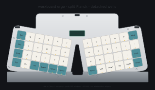

# worxboard ergo

An open ergonomic TKL keyboard: familiar row stagger, angled key fields, split spacebars, and a memory LCD between the hands. Inspired by the supplied ergonomic keyboard references, Microsoft Sculpt 1559, and [System76 Launch](https://github.com/system76/launch).

**A0 engineering starter — not ready to manufacture.** CAD and firmware are generated and checked; PCB routing and physical validation are open. See [verification](docs/verification.md) before printing or ordering anything.



| Feature | Design |
|---|---|
| Layout | 87 keys; function row, navigation block, inverted-T arrows; no numpad |
| Ergonomics | Single assembled body, 10° outward rotation per key field, 48 mm top center gap, removable palm rest |
| Full-height option | Cherry MX-compatible switches and Kailh MX hot-swap sockets |
| Low-profile option | **Kailh Choc v1 / PG1350** hot-swap; separate PCB and plate |
| Controller | Bare RP2040, 16 MiB QSPI flash, reset/BOOT buttons and SWD access |
| Connection | Wired USB 2.0 full speed only; no battery, Bluetooth, or radio |
| USB-C | Three alternative host inputs: rear-left, rear-center, rear-right |
| Selection | TS3USB3031 data mux; center-first at startup, retain selected powered port |
| Display | Center landscape nice!view-class 160×68 Sharp memory **LCD**, SPI, layer status |
| Firmware | Pinned ZMK; BASE / FN / MAINT layers; USB Studio transport |
| CAD | Python/build123d source, STEP, STL, 3MF, and native FreeCAD FCStd |
| Electronics | KiCad 10 schematics, XML netlists, footprints, placed **unrouted** PCBs |

The three USB-C receptacles are alternative cable positions, as requested. They are not downstream hub ports. Launch's hub, QMK firmware, configurator, and certifications do not transfer to this design. The complete upstream Launch tree is retained as a pinned [reference submodule](references/system76-launch); [feature coverage](docs/launch-coverage.md) records the differences and remaining goals, including per-key RGB.

## Open the files

- **MX:** [FreeCAD](cad/exports/mx/worxboard-ergo-mx.FCStd), [assembly STEP](cad/exports/mx/assembly.step), [printable parts](cad/exports/mx), [KiCad project](pcb/mx/worxboard-ergo-mx.kicad_pro).
- **Choc v1:** [FreeCAD](cad/exports/choc/worxboard-ergo-choc.FCStd), [assembly STEP](cad/exports/choc/assembly.step), [printable parts](cad/exports/choc), [KiCad project](pcb/choc/worxboard-ergo-choc.kicad_pro).
- **Firmware:** [board definition](firmware/boards/worxbend/worxboard_ergo), [shared UF2](firmware/artifacts), [build and flash instructions](docs/firmware.md).
- **Build planning:** [design](docs/design.md), [electrical design](docs/electrical.md), [KiCad workflow](docs/pcb-seed.md), [BOM](docs/bom.csv), [assembly](docs/assembly.md), [roadmap](docs/roadmap.md).

FCStd files contain named B-rep assembly parts. The parametric source is [cad/model.py](cad/model.py), driven by [layout/model.py](layout/model.py). The keycaps, display and PCB in assembly STEP are envelopes for design review; keycap solids are not functional printable keycaps.

## Reproduce

Install [uv](https://docs.astral.sh/uv/), Docker, and FreeCAD 1.1.x. Run:

```sh
git clone https://github.com/w0rxbend/worxboard-ergo.git
cd worxboard-ergo
uv sync --locked
make references     # complete Launch tree and pinned QMK source
make generate       # canonical layout and ZMK physical layout/keymap
make cad            # STEP/STL/3MF, topology and STEP round-trip checks
make native         # native FreeCAD assemblies and save/reopen report (Flatpak)
make test           # layout, circuit contracts, meshes and USB selection behavior
make pcb            # KiCad seed files, ERC/DRC reports; DOES NOT route the boards
make firmware       # pinned ZMK workspace -> UF2
make manifest       # artifact SHA-256 inventory
```

`FREECAD_CMD=/path/to/FreeCADCmd make native` supports a non-Flatpak installation. Docker images and Python dependencies are pinned in [toolchain.lock.json](toolchain.lock.json) and `uv.lock`. A firmware build requires network access for the pinned west dependencies. `make check-fabrication` deliberately fails until both PCB variants meet the manufacturing gate; it does not suppress unrouted-net errors.

## Next milestone

[A1: electrical and mechanical prototype review](docs/roadmap.md). Route the two variants, review USB power and signal integrity, select actual Choc-compatible stabilizers/keycaps, print switch/USB/display fit coupons, and test a populated PCB before ordering a complete case. The initial case is flat; Sculpt-style three-dimensional tenting and negative tilt remain design work.

Original project work is GPL-3.0-or-later. ZMK, upstream reference sources and third-party footprint licenses retain their own notices; see [THIRD_PARTY.md](THIRD_PARTY.md). This is an independent project, without System76 or Microsoft affiliation.
