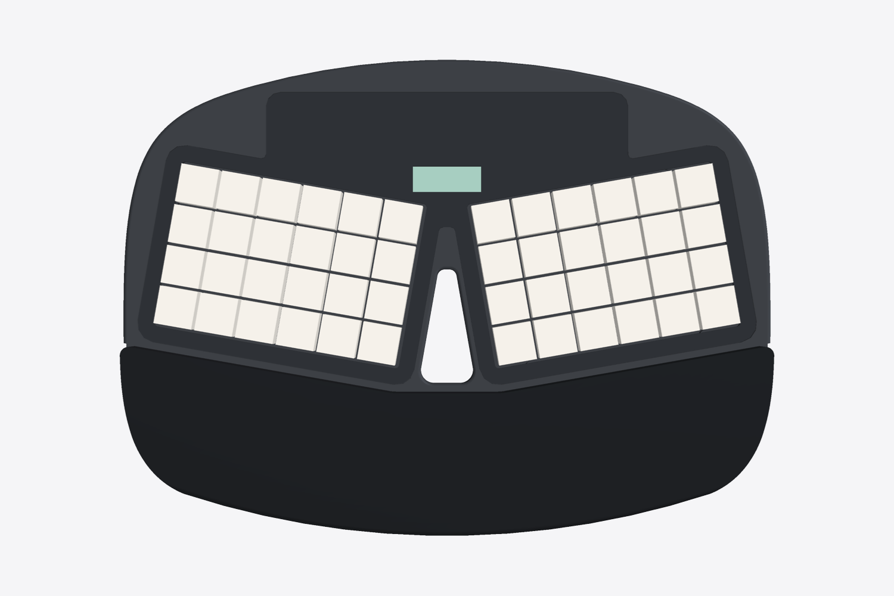
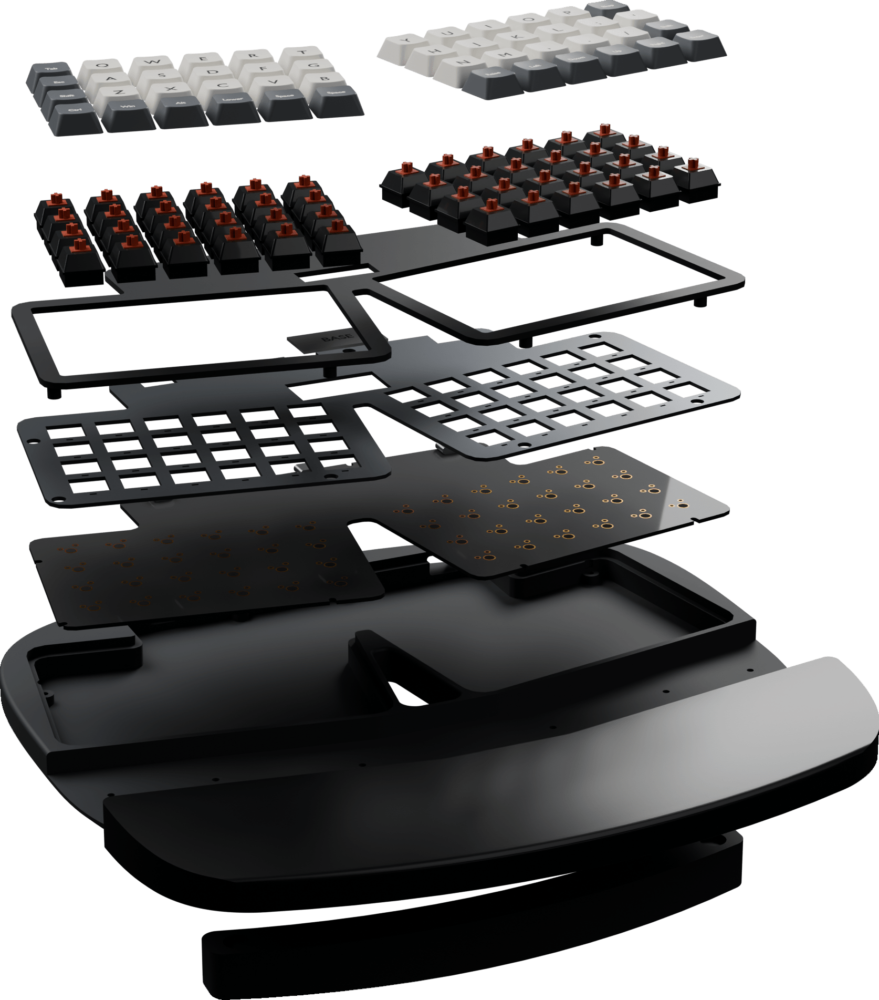

# worxboard ergo

[](https://github.com/w0rxbend/worxboard-ergo/actions/workflows/ci.yml)
[](https://github.com/w0rxbend/worxboard-ergo/releases)
[](LICENSE)



A split Planck in one curved shell. Forty-eight 1u keys in two wells, opened ten degrees. A full-width palm rest, a memory LCD between the wells, and three places to plug in one USB-C cable. Cherry MX or Kailh Choc v1.

**[Product page](https://w0rxbend.github.io/worxboard-ergo/)** · **[3D print guide](docs/printing.md)** · **[Releases](https://github.com/w0rxbend/worxboard-ergo/releases)**

> [!WARNING]
> **Revision A0 is an engineering preview.** You can print the case. You cannot order the PCB: it has no copper tracks. No keyboard has been built, and the firmware has never run on a board. The picture is a render of the CAD model.

## What you can do today

| You want to | Start here | State |
|---|---|---|
| See the design | [Product page](https://w0rxbend.github.io/worxboard-ergo/) | Renders of the CAD model |
| Print the case | [3D print guide](docs/printing.md) | Watertight meshes. Nothing printed yet |
| Mill the case | [CNC traveler](docs/cnc.md) | STEP geometry. No toolpath |
| Read the circuit | [Electrical notes](docs/electrical.md) | Schematic and placed parts. **Zero tracks** |
| Build the firmware | [Firmware notes](docs/firmware.md) | Compiles. Never flashed to hardware |
| Order a PCB | — | **Blocked.** See [verification](docs/verification.md) |

## The design

| | |
|---|---|
| Layout | 48 ortholinear keys, two blocks of 4 × 6, every key 1u. Numbers and F-keys on the Lower layer |
| Shell | 303 × 223 mm. A curved outline, an open slot between the wells, a flush top cover |
| Ergonomics | 10° splay, 67 mm palm rest, flat stance, 6.7° negative tilt on an optional magnetic riser |
| Switches | Cherry MX compatible with a 1.5 mm plate, or Kailh Choc v1 with a 1.2 mm plate. Hot-swap sockets |
| Controller | Bare RP2040 with 16 MiB flash, reset, BOOT, and SWD |
| Cable | Three USB-C positions, one host at a time. No battery, no radio |
| Display | 160 × 68 memory LCD that names the active layer |
| Firmware | ZMK at a pinned revision |

Both wells sit on one flat board, so the keys do not tent. The three USB-C jacks are alternative cable positions, not a hub.



## Print the case

1. Choose [MX](cad/exports/mx) or [Choc v1](cad/exports/choc). The parts do not mix.
2. Choose whole parts (350 mm class bed) or split halves (about 235 mm).
3. Print the four test pieces, then the chassis, plate, top cover, and palm rest.

The full steps, orientation, settings, and screw list are in the [3D print guide](docs/printing.md).

## Repository map

| Path | What it holds |
|---|---|
| [`layout/model.py`](layout/model.py) | Source of truth for key positions, key order, and shared holes |
| [`cad/model.py`](cad/model.py) | Parametric case model (build123d) |
| [`cad/exports/`](cad/exports) | STEP, STL, 3MF, and FreeCAD files for both switch families |
| [`pcb/`](pcb) | KiCad 10 projects, generator scripts, ERC and DRC reports |
| [`firmware/`](firmware) | ZMK board definition, USB port selector, compiled UF2 |
| [`site/`](site) | Product page, published with GitHub Pages |
| [`docs/`](docs/README.md) | Guides, design record, verification, roadmap |
| [`tools/`](tools) | Generators and checks behind the `make` targets |
| [`tests/`](tests) | Geometry and contract tests |

## Reproduce the files

Install [uv](https://docs.astral.sh/uv/), Docker, and FreeCAD 1.1.x.

```sh
git clone --recurse-submodules https://github.com/w0rxbend/worxboard-ergo.git
cd worxboard-ergo
uv sync --locked
make generate       # layout drawing and ZMK keymap
make cad            # STEP, STL, 3MF, solid and fit checks
make native         # FreeCAD save and reopen
make test
make pcb            # KiCad boards and ERC/DRC reports. Does not route
make firmware       # pinned ZMK image
make manifest       # checksums
make check-fabrication   # fails on purpose at A0
```

`make check-fabrication` stays red until both boards are routed, reviewed, and tested on hardware. Tool versions are pinned in [`toolchain.lock.json`](toolchain.lock.json) and `uv.lock`.

To redraw the product renders:

```sh
uv run --with pyvista==0.46.3 python -m tools.render
```

## Status and next steps

The next gate is [A1, electrical and mechanical review](docs/roadmap.md). The main open work:

- Route both PCBs. Turn the USB jacks to face the rear wall and move the parts that sit under the plate.
- Print the test pieces and measure them.
- Review USB power and the J6/J7 flashing override on real hardware.

The evidence for every claim is in [verification](docs/verification.md). Changes per release are in the [changelog](CHANGELOG.md).

## License

Original project work is GPL-3.0-or-later. ZMK, the reference tree, and third-party footprints keep their own notices. See [THIRD_PARTY.md](THIRD_PARTY.md).

This is an independent project. It is not affiliated with Microsoft, System76, or OLKB. The [System76 Launch](https://github.com/system76/launch) tree is a pinned [reference submodule](references/system76-launch); [feature coverage](docs/launch-coverage.md) records the differences.

The product page sets [Outfit](https://github.com/Outfitio/Outfit-Fonts) under the SIL Open Font License. The license text ships in [site/fonts](site/fonts).
