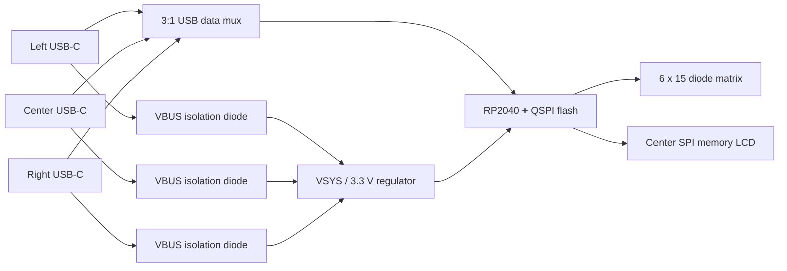

# Electronics and USB architecture

A bare RP2040 scans a 6×15 matrix with one 1N4148W diode per key. Column -> switch -> diode anode -> diode cathode -> row gives `col2row`. Rows GP0–5 are inputs with pull-down; columns GP6–20 are outputs. A W25Q128JVSIQ provides 16 MiB of QSPI flash; the final 512 KiB is reserved for settings. A 12 MHz crystal, RP2040 supply decoupling, AP2112K 3.3 V regulator, reset, BOOT and SWD test points are included in the schematic.

| GPIO | Function |
|---|---|
| 0–5 | Matrix ROW0–5 |
| 6–20 | Matrix COL0–14 |
| 21 / 22 | USB mux SEL0 / SEL1 |
| 23 / 24 / 25 | Left / center / right pre-diode VBUS sense |
| 26 / 27 / 28 | SPI1 SCK / MOSI / LCD CS (active high) |
| 29 | Reserved RGB output header; not enabled in firmware |

Each USB-C receptacle has independent CC1/CC2 5.1 kΩ sink resistors, its own D+/D− ESD clamp, and a B5819W diode from its VBUS to VSYS. No host VBUS rails are directly tied. The diode OR permits the controller to remain powered if several inputs are connected. Diode leakage, voltage drop, attach current and transient behavior need measurement; this is not a certified multi-host product. Ground is common; there is no galvanic isolation.

A TI TS3USB3031 isolates the three USB data pairs. Its datasheet truth table is `SEL1:SEL0 = 00 left, 01 center, 10 right, 11 high impedance`. The third differential path is labelled MHL+/− by TI; USB full-speed operation on that path still needs bench verification. Both selector bits have 10 kΩ pull-ups, so the default state is disconnected while RP2040 resets. Each pre-diode VBUS rail is divided by 10 kΩ/10 kΩ for GPIO detection. At a nominal 5 V input this is 2.5 V; verify input thresholds across supply/tolerance extremes.

The ZMK module polls VBUS, uses the center/left/right priority only when choosing a new input, and retains a selected powered input. It enters high impedance for 25 ms before selecting another input. Masked GPIO writes change both selection bits together. This behavior is tested on the host and compiled for RP2040, but actual mux switching, host enumeration and reconnect behavior require hardware. It is cable-position selection, not a KVM feature or simultaneous multi-host keyboard.

USB inputs operate at USB 2.0 full speed through the RP2040 PHY. No PD, charging, USB 3.x, or peripheral hub is included. The 27 Ω USB series resistors belong close to the RP2040. Route each D+/D− pair together over a continuous reference plane, minimize branches at the duplicated receptacle pads, and tune the differential geometry to the selected fabricator's stackup. Four copper layers are selected for the seed board, but the controlled stackup and copper planes are not yet designed.

The present `.kicad_pcb` files contain footprints and complete pad net assignments with **zero routed tracks**. They are editable placement seeds. Service-strip placement is provisional; the MCU power parts, crystal and USB components must be moved into correct local groups. The current DRC findings are committed, including unconnected nets and placement problems. No Gerbers or fabrication-ready claims are supplied.

The RGB header exposes VSYS, GP29 data and ground. It does not implement Launch's per-key RGB. A1 must choose a low-current LED architecture, add a suitable data level shifter and power switch, calculate pre-enumeration/suspend current, and include LED cutouts and decoupling. Do not attach an unrestricted LED chain directly to this header.

J6 and J7 each take a single 2-pin shunt on a 3-pin header. Put both shunts on pins 1–2 for normal firmware selection. For ROM flashing, disconnect USB, move both to pins 2–3, and use only the center USB input. This fixes SEL0=1 and SEL1=0 while disconnecting the firmware control signals, so ROM USB can work without executing the selector code. Hold BOOT while pressing RESET, then copy UF2 to RPI-RP2. Disconnect USB before restoring both shunts to 1–2. Both settings and physical pin numbering must be checked during A1; SWD remains the first bring-up/recovery method. The 1 kΩ firmware-side resistors also limit accidental drive contention during jumper mistakes.

The UF2 is a compiled development artifact, not a claim of working hardware. Do not move shunts while the board is powered.

