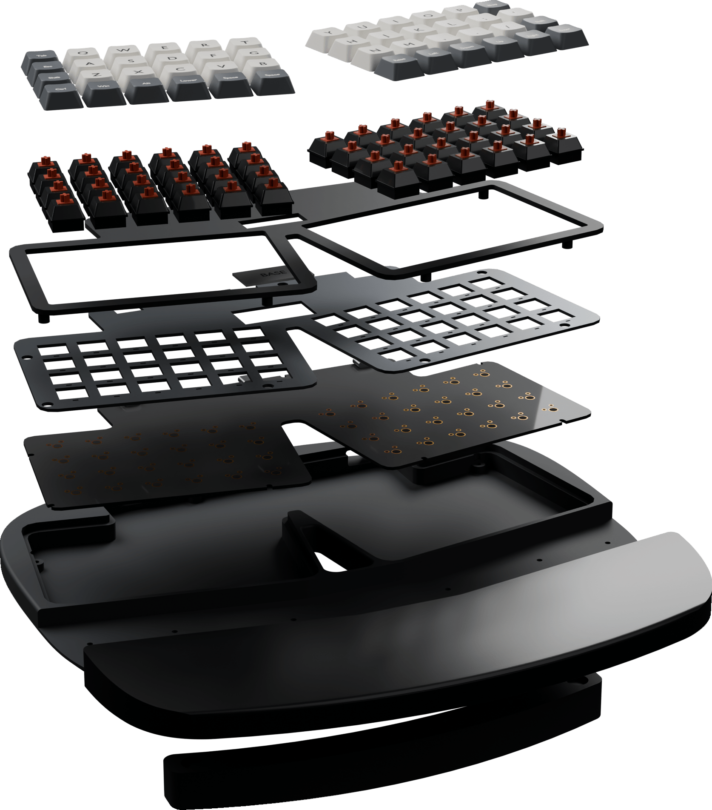

# 3D print guide

This guide takes you from the files in this repository to a printed case on your desk. It covers the case only. The PCB is not routed and cannot be ordered, so a printed case today is a fit and feel check, not a working keyboard.

Nothing here has been printed yet. Settings are a starting point, not a proven profile. Print the small test pieces first and expect to adjust.

## Before you start

You need:

- A printer with a bed of 235 mm or more in one direction for the split case, or a 350 mm class bed for the one-piece case.
- Up to 1 kg of PETG or ASA. The MX parts total about 790 cm³ as solid volume, and infill lowers the real figure. No print has been weighed.
- Fourteen M2.5 thread-forming screws. Measure the length you need from your printed parts (see [Screws](#screws)).
- Four 10 mm stick-on pads. For the riser, two more pads and eight 6 × 3 mm disc magnets.
- A few switches of the family you chose, and a USB-C cable, for the test pieces.

## 1. Choose a switch family

MX and Choc v1 share the key map. They do not share any printed part except the riser.

| | MX | Choc v1 |
|---|---|---|
| Files | [`cad/exports/mx`](../cad/exports/mx) | [`cad/exports/choc`](../cad/exports/choc) |
| Chassis height | 15.5 mm | 12.7 mm |
| Plate thickness | 1.5 mm | 1.2 mm |
| Switch opening | 14.0 mm square | 13.8 mm square |

Each [release](https://github.com/w0rxbend/worxboard-ergo/releases) carries one zip per family with the same files.

## 2. Choose whole or split parts

| Part | One piece | Split | Size of the largest piece |
|---|---|---|---|
| Chassis | `chassis.stl` | `chassis_left.stl`, `chassis_right.stl` | 303 × 223 mm whole, 169.5 × 223 mm split |
| Plate | `plate.stl` | `plate_left.stl`, `plate_right.stl` | 289 × 136 mm whole |
| Top cover | `top_cover.stl` | `top_cover_left.stl`, `top_cover_right.stl` | 289 × 136 mm whole |
| Palm rest | `palm_rest.stl` | `palm_rest_left.stl`, `palm_rest_right.stl` | 303 × 88 mm whole |
| Riser (optional) | `riser.stl` | one piece only | 224 × 33 mm |

Every STL has a matching `.3mf` and `.step`. The 3MF files carry geometry in millimeters and nothing else: no temperatures, no infill, no supports.

The split chassis joins on an 18 × 18 mm tab in the rear wall. The palm rest then bridges the front. The tab is modeled and has never been fitted.

## 3. Orient the parts

The files keep their position in the assembly. Reorient each one in the slicer.

| Part | Face on the bed | Supports |
|---|---|---|
| Chassis | The flat underside | None expected. The underside pockets are shallow. |
| Plate | Either flat face | None |
| Top cover | The top face, bosses pointing up | None |
| Palm rest | The flat bottom | None. The curved top will show layer steps. |
| Riser | The flat top face | None expected |

## 4. Slicer settings to start from

| Setting | Value |
|---|---|
| Material | PETG or ASA |
| Layer height | 0.2 mm |
| Perimeters | 4 |
| Infill | 20 % for the chassis and palm rest, 100 % for the plate |
| Nozzle | 0.4 mm |

No slicer run backs these values. If the plate flexes when you press a switch in, print it thicker walls first, then consider a metal plate from the STEP file (see the [CNC traveler](cnc.md)).

## 5. Print the test pieces

Cut these from the full meshes in your slicer, or print a small region. Do them in this order. Each one checks a fit that the model alone cannot prove.

1. **One switch opening** from the plate. A switch must clip in, travel fully, and release.
2. **The center tab**, left and right corners of the split chassis. The halves must meet without force and without a visible gap. Skip this for a one-piece case.
3. **One USB tunnel** from the rear wall: 14 mm wide and 7.8 mm tall. A USB-C plug must pass through freely. It is roofed on MX and open on Choc v1.
4. **One top-cover boss** with its screw driven from below.

If a test piece does not fit, change the value in [`cad/model.py`](../cad/model.py) and run `make cad`. Do not file the print and keep the old file.

## 6. Print the case

Print the chassis, plate, top cover, and palm rest for your family. Print the riser if you want the negative tilt.

## Screws

All fourteen screws enter from the underside.

| Count | Path | Pilot in the printed part |
|---|---|---|
| 8 | Chassis boss, PCB hole, into the top cover | 2.1 mm, 6.7 mm deep on MX, 3.9 mm on Choc v1 |
| 6 | Front shelf, into the palm rest | 2.1 mm, 6 mm deep |

The chassis holes are 2.8 mm with a 5.2 × 2.2 mm counterbore. The pilots are sized for thread-forming screws. They are too small for heat-set inserts. Screw length is not specified: measure the stack on your own parts, and stay shorter than the pilot depth.

## 7. Assemble a case without a board

1. Lay the chassis on its underside.
2. Seat the plate in its recess.
3. Press the top cover into the rim. Its bosses pass through the plate.
4. Without a PCB, the eight cover screws clamp nothing between boss and cover. Fit them loosely, only to hold the cover.
5. Set the palm rest on the front shelf and drive its six screws from below.
6. Stick the four pads into the 10.2 mm recesses on the underside.
7. For the riser, press the magnets into its pockets and the matching chassis pockets, check polarity before gluing, and drop the riser over the two front pads.

The full stack with a board is in the [build guide](build.md#6-assemble-after-a-real-pcb-exists).

## Known limits

- No part has been printed. Shrinkage, warping, and fit are unmeasured.
- The USB tunnels assume the jacks will move to face the rear wall. The current PCB places them the other way. See [verification](verification.md).
- The palm rest top is a curved surface printed in layers. Expect to sand it, or print it at a finer layer height.
- The Choc v1 USB openings are open notches, not tunnels.
- The keycap and display shapes in `assembly.step` are plain blocks. Do not print them as parts.
